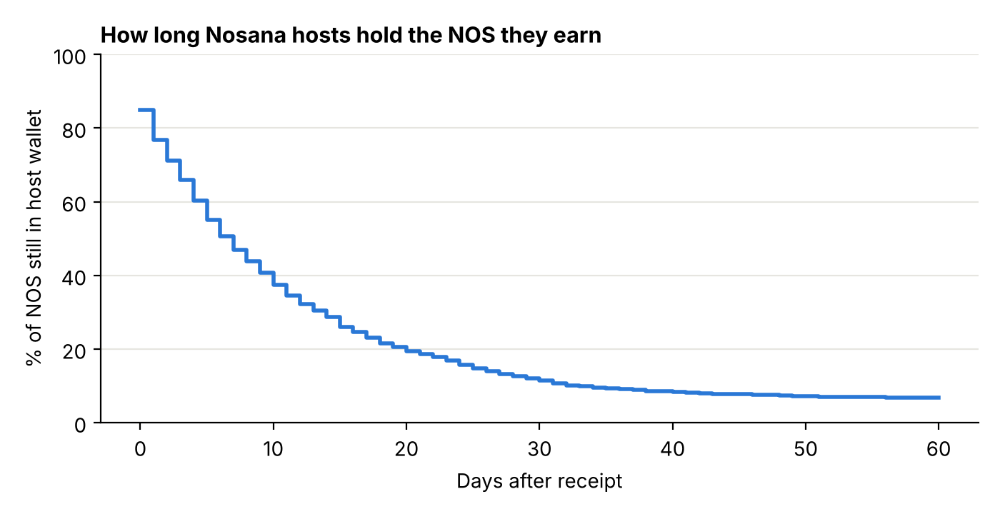
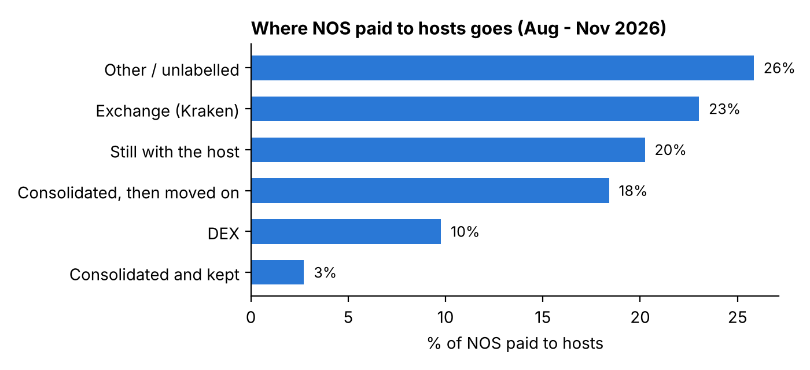

# Nosana host reward flows: who sells, how fast, and where

On-chain analysis of what GPU hosts on [Nosana](https://nosana.com) (decentralized GPU compute on Solana) do with the NOS tokens they earn from jobs.

**Question:** what share of NOS paid to hosts is sold, how quickly, through which venues, and do large operators behave differently from small hosts?

Data: Solana mainnet, **13 Aug – 11 Nov 2026**, via the [Coinbase CDP SQL API](https://docs.cdp.coinbase.com/data/sql-api/welcome).
Author: Denis Foguenne · November 2026 · work in progress (v1)

---

## Key findings (v1)

| | |
|---|---|
| NOS paid to hosts for jobs | **444,504 NOS** to **668 hosts** (~4,900 NOS / day, ≈ $2k / day) |
| Refunds to job clients (excluded) | **1.74M NOS**, ~80% of all vault outflows |
| Concentration | top 10% of hosts (67) receive **47%** of payouts |
| Half-life in host wallets | **~7 days** (Kaplan-Meier, any outflow) |
| Sold within 30 days | **36%** directly (CEX + DEX), **57%** including consolidation wallets that were emptied |
| Large vs small hosts (sold within 30 days) | **80%** for the top 10% vs **37%** for the other 90% |
| Main sell route | **Kraken deposit address** (one operator, 25 host wallets), not on-chain DEX pools |

**Market impact:** the host sell flow is real but small: roughly $1.1–1.2k of NOS per day, under 0.5% of NOS daily trading volume. Host emissions are not a meaningful driver of NOS price pressure at current network usage.




---

## Method

### 1. Find who pays hosts
A completed job on [explore.nosana.com](https://explore.nosana.com) showed the host's payment coming from `Dqx5Mbc…` (0.2565 NOS, matching the job price). That address paid 112 hosts, all on the RTX 3090 market: **each GPU market has its own vault**.

The vault is a Program Derived Address of the Nosana Jobs program (`nosJhNRq…`) with seeds `[market, NOS mint]`. `derive_vaults.py` reproduces `Dqx5Mbc…` from the 3090 market address, then derives the vaults of all 48 markets listed by `api.nosana.com/api/markets`.

### 2. Separate host payments from client refunds
Clients deposit NOS into a vault for the maximum job duration and get the remainder back when a job stops early. Refunds look exactly like payments. Rule: **any address that has ever deposited NOS into a vault is a client** and is excluded (`sql/q4_host_payouts_per_market.sql`, anti-join with `LEFT JOIN … IS NULL`).

### 3. Classify where hosts send NOS
The top destinations of host outflows (`sql/q5_host_outflow_destinations.sql`) were labelled manually on Solscan:

| Category | Addresses |
|---|---|
| CEX | Kraken deposit address `Epz7DFBN…` |
| DEX | OKX DEX router, Raydium NOS-USDC and WSOL-NOS (CLMM), Raydium Authority V4, Orca SOL-NOS, Titan Exchange |
| Consolidation, then emptied | `9uVHh78U…`, `7YGRTc8m…`, `EkTvSTm9…` (personal wallets collecting from many hosts, near-zero NOS balance today) |
| Consolidation, kept | `JC6fRXbo…`, `FHNGA3iZ…` (still hold the NOS) |
| Other | everything else (~15% of host outflow volume was not labelled) |

### 4. Holding time (FIFO + Kaplan-Meier)
`fifo_analysis.py` works per host: every payment day creates a lot, every outflow consumes the oldest lots first. Shares "sold within N days" only use NOS received at least N days before the end of the data (right-censoring). The holding curve is an amount-weighted Kaplan-Meier estimator.

---

## Limitations

- **Upper bound on sell speed.** Hosts also sent out 345k NOS that cannot be matched to any payment in the period (bought, or held before August). The model assumes every host starts at zero on 13 Aug; if older NOS were sold first, rewards are actually held longer.
- **CEX deposits are counted as sales.** A transfer to Kraken is likely, not certainly, a sale.
- **Labels are partial.** About 15% of outflow volume goes to unlabelled addresses ("other").
- **Client filter is conservative.** A host that also rented GPUs is excluded (e.g. 3090 market: 112 → 77 addresses).
- **Uptime rewards** may be paid from another address and are not included yet.
- **Active markets only.** Markets closed before November are not in the vault list.
- **Daily granularity.** Same-day receipt and sale count as a 0-day holding period.
- Prices and volumes used for the market-impact estimate are approximate (NOS ≈ $0.41, ≈ $380k daily volume, early November 2026).

## Next steps (v2)

- Follow consolidation wallets one more hop to confirm sales.
- Relate host selling to NOS price moves (mechanical vs price-sensitive sellers).
- Add uptime rewards and closed markets.
- Monthly update of the dataset.

---

## Reproduce

```bash
pip install -r requirements.txt
python derive_vaults.py                     # data/market_vaults.csv
# export the SQL results (needs a CDP Secret API key in cdp_api_key.json, never committed)
python fetch_exports.py sql/q6a_received_per_host_day.sql sql/q6b_sent_per_host_day.sql
python fifo_analysis.py                     # output/*.csv, output/*.png
```

```
sql/        SQL queries (Coinbase CDP SQL API, ClickHouse dialect)
data/       query exports + market → vault mapping
output/     FIFO results, holding curve, charts
```

Not investment advice. All data is public on-chain data.
