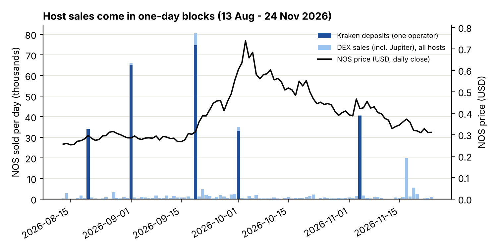
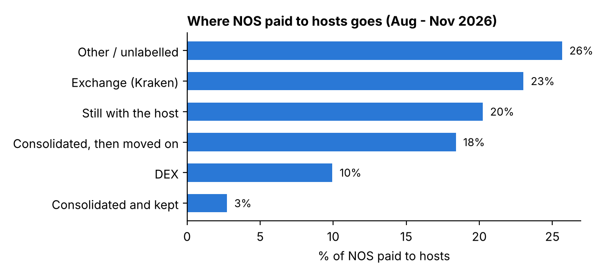
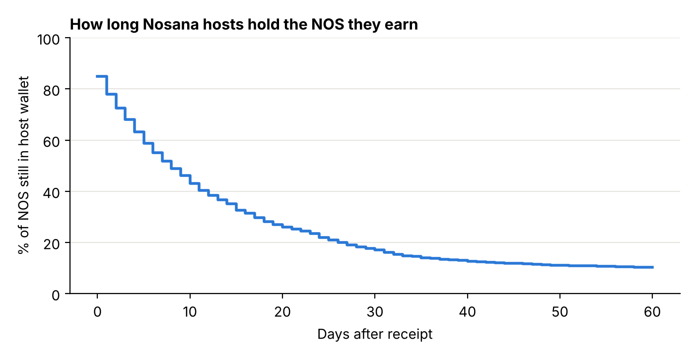

# Nosana host reward flows: who sells, how fast, where, and when

On-chain analysis of what GPU hosts on [Nosana](https://nosana.com) (decentralized GPU compute on Solana) do with the NOS tokens they earn from jobs.

**Questions:** what share of NOS paid to hosts is sold, how quickly, through which venues, do large operators behave differently from small hosts, and does host selling react to the NOS price?

Data: Solana mainnet, **13 Aug – 25 Nov 2026 (105 days)**, via the [Coinbase CDP SQL API](https://docs.cdp.coinbase.com/data/sql-api/welcome); NOS price and volume from CoinGecko.
Author: Denis Foguenne · November 2026 · v2 ([v1](../../tree/v1) for the first version)

---

## Key findings (v2)

| | |
|---|---|
| NOS paid to hosts for jobs | **557,556 NOS** to **682 hosts** (~5,300 NOS / day) |
| Concentration | top 10% of hosts (68) receive **49%** of payouts |
| Half-life in host wallets | **8 days** (Kaplan-Meier, any outflow) |
| Sold within 30 days | **38%** directly (CEX + DEX), **68%** including consolidation wallets and sales one hop later |
| Large vs small hosts (sold within 30 days) | **84%** for the top 10% vs **56%** for the other 90%. Large hosts hold slightly longer (half-life 10 vs 6 days) but end up selling almost everything |
| Main sell routes | **Kraken** deposit address (one operator), then **Jupiter** and Raydium / Orca / Meteora pools |

**Sales come in blocks.** 79% of direct host sales happened on just 8 of 104 days. Five of them are batch deposits to Kraken by one operator (34k–75k NOS each, roughly every 2–3 weeks, with a 34-day pause during the October drawdown). On average host selling is small (~$1.3k / day), but on block days it reaches **up to 8% of NOS daily trading volume**. These blocks are visible on-chain before they reach an order book.

**Price sensitivity: modest, in one direction.** After an up week (+22% on average), hosts sell a median 19% of their recent daily payouts per day, vs 10% after a down week (−15%): about 2× more. The previous day's return is significant at 5% (OLS on log(1 + sell ratio), Newey-West errors, p = 0.04). Hosts sell into strength and do not panic-sell in drawdowns. Host flows are too small on average to move the price, so the direction of causality runs from price to selling.





---

## Method

### 1. Find who pays hosts
A completed job on [explore.nosana.com](https://explore.nosana.com) showed the host's payment coming from `Dqx5Mbc…` (0.2565 NOS, matching the job price). That address paid 112 hosts, all on the RTX 3090 market: **each GPU market has its own vault**.

The vault is a Program Derived Address of the Nosana Jobs program (`nosJhNRq…`) with seeds `[market, NOS mint]`. `derive_vaults.py` reproduces `Dqx5Mbc…` from the 3090 market address (pure Python: base58, sha256, ed25519 off-curve check), then derives the vaults of all 48 markets listed by `api.nosana.com/api/markets`.

### 2. Separate host payments from client refunds
Clients deposit NOS into a vault for the maximum job duration and get the remainder back when a job stops early. Refunds look exactly like payments. Rule: **any address that has ever deposited NOS into a vault is a client** and is excluded (anti-join `LEFT JOIN … IS NULL`, since CDP does not allow `NOT IN`). Refunds are ~80% of all vault outflows.

### 3. Classify where hosts send NOS (two hops)
Destinations of host outflows were labelled on Solscan:

| Category | Addresses |
|---|---|
| CEX | Kraken deposit address `Epz7DFBN…` |
| DEX | OKX DEX router, Raydium NOS-USDC / WSOL-NOS / Authority V4, Orca SOL-NOS and NOS-RENDER, Meteora NOS-WSOL, Titan, **16 Jupiter Aggregator Authorities** |
| Sold one hop later | personal wallets that later send NOS to a sale venue (pro-rata, see below) |
| Consolidation, then emptied / kept | wallets collecting from many hosts, near-zero / non-zero NOS balance today |
| Other | everything else: **14%** of NOS paid to hosts |

**Second hop** (`sql/q7*`, `sql/q9*`): for each unlabelled wallet receiving host NOS, we measure total NOS received and NOS sent to sale venues. The share of host NOS counted as sold through that wallet is `min(1, sent to sale venues / total received)`. This found the Jupiter authorities (same profile: ~1M NOS in and out, zero balance, NOS from 8–33 hosts each) and cut the unlabelled share from 26% (v1) to 14%. 206 first-hop addresses received 0 NOS (zero-value "address poisoning" transfers) and are ignored.

### 4. Daily panels and the 90-day window
The CDP SQL API keeps **90 days of history**. The v1 export (13 Aug – 11 Nov) is archived in `data/archive_2026-11-11/`; the v2 export covers 28 Aug – 26 Nov. They are merged: v1 before 28 Aug, v2 after (the overlapping days match within 0.4%). Exports are aggregated per host and day (`sql/q8a`, `sql/q8b`) to stay within CDP query limits.

### 5. Holding time (FIFO + Kaplan-Meier)
`fifo_analysis.py` works per host: every payment day creates a lot, every outflow consumes the oldest lots first (sale venues first within a day). Shares "sold within N days" only use NOS received at least N days before the end of the data (right-censoring). The holding curve and the per-segment half-lives are amount-weighted Kaplan-Meier estimators, S(t) = Π (1 − dₜ / nₜ), where NOS still held at the end of the data is censored, not dropped.

### 6. Price sensitivity
`price_sensitivity.py` builds a daily panel of payouts, direct sales (CEX + DEX) and NOS price.
- **Sell ratio** = NOS sold on day t / average daily payouts over the previous 7 days, to remove the effect of network activity.
- **Model:** log(1 + sell ratio) = a + b₁ rₜ + b₂ rₜ₋₁ + b₃ r7ₜ₋₁ (daily log returns, 7-day trailing return), OLS with Newey-West standard errors (5 lags), for all hosts, the top 10% and the other 90%.
- Robustness: raw sell ratio (not significant: a few block sales dominate), price relative to its 30-day average, medians by tercile of the trailing 7-day return.
- OLS and Newey-West are implemented in numpy (no external stats library).

---

## Limitations

- **Upper bound on sell speed.** Hosts sent out 411k NOS that cannot be matched to a payment in the period (bought, or held before August). The model assumes every host starts at zero on 13 Aug; the 90-day CDP window makes a longer history impossible.
- **Second-hop sales are pro-rata and undated.** They are counted at the date of the first transfer, which makes those sales look slightly faster than they are.
- **13–27 Aug use v1 labels** (no Jupiter, no second hop): under 15% of the period.
- **CEX deposits are counted as sales.** A transfer to Kraken is likely, not certainly, a sale.
- **Client filter is conservative.** A host that also rented GPUs is excluded.
- **Price analysis:** 96 daily observations, low R² (0.06); the price effect is significant only in the log specification. CoinGecko snapshots at 00:00 UTC are used as the previous day's close, so the price panel ends on 24 Nov.
- **Uptime rewards** may be paid from another address and are not included. Markets closed before November are not in the vault list.

## Changelog

**v2 (26 Nov 2026)**
- Merged two exports to cover 105 days despite the 90-day CDP retention.
- Second-hop tracing of unlabelled wallets; Jupiter, Orca NOS-RENDER and Meteora added as sale venues. Unlabelled share 26% → 14%.
- Large vs small host gap revised from 80% vs 38% to 84% vs 56%: part of the v1 gap came from small hosts selling through personal wallets.
- New: price sensitivity analysis and daily sales chart.
- Fixes from review: censored half-lives per segment, deterministic intra-day order, consistent "unlabelled" figures.

**v1 (Nov 2026):** first version, 13 Aug – 11 Nov, direct destinations only.

## Next steps

- Scheduled job to archive CDP exports before they leave the 90-day window, feeding a live dashboard.
- Add uptime rewards and closed markets.

---

## Reproduce

```bash
pip install -r requirements.txt
python derive_vaults.py                     # data/market_vaults.csv
# exports (needs a CDP Secret API key in cdp_api_key.json, never committed)
python fetch_exports.py sql/q8a_received_per_host_day_v2.sql sql/q8b_sent_per_host_day_v2.sql
python fetch_exports.py sql/q9a_other_wallet_in.sql sql/q9b_other_wallet_out.sql
python fifo_analysis.py                     # holding time, destinations, segments
python price_sensitivity.py                 # needs data/nos_usd_coingecko.csv
```

```
sql/        SQL queries (Coinbase CDP SQL API, ClickHouse dialect)
data/       exports, v1 archive, market → vault mapping, NOS price
output/     results (CSV) and charts
```

Not investment advice. All data is public on-chain data.
